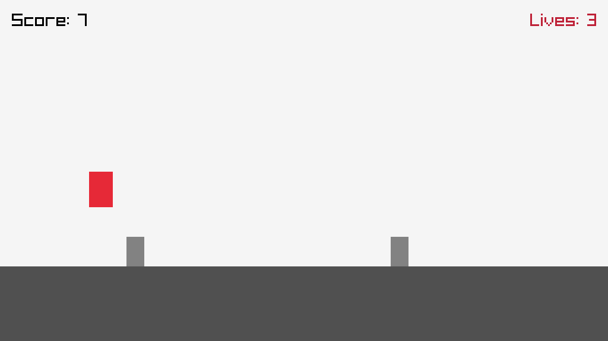

# Runner

A red player on the ground jumps over grey obstacles scrolling from the right.
1024x576 window, 60 fps, 3 lives, GAME OVER after 3 collisions.



## Controls

| Key   | Action                        |
|-------|-------------------------------|
| Space | Jump                          |
| Enter | Play again after GAME OVER    |
| Esc   | Quit the window               |

Score: +1 for every obstacle that leaves the screen without hitting the player.

## Build and run

You only need CMake (3.16 or newer) and a C++17 compiler. Raylib 5.5 is downloaded
by CMake (`FetchContent`) the first time you configure: that step needs Internet
access and takes about a minute. Nothing else to install.

### Command line (all systems)

```bash
cmake -S . -B build
cmake --build build
```

Then run the game:

| System                          | Command                       |
|---------------------------------|-------------------------------|
| Linux / macOS / Windows (MinGW) | `./build/runner`              |
| Windows (Visual Studio)         | `build\Debug\runner.exe`      |

### IDEs

- **CLion**: *File → Open* the project folder, wait for CMake to finish, then Run `runner`.
- **Visual Studio 2022**: *File → Open → Folder*, pick `runner.exe` as startup item, then Run.
- **VS Code**: install the *CMake Tools* extension, open the folder, then *CMake: Build* and *CMake: Run Without Debugging*.

### Extra packages

- **Linux** needs the X11/OpenGL headers:
  ```bash
  sudo apt install libx11-dev libxrandr-dev libxinerama-dev libxcursor-dev libxi-dev libgl1-mesa-dev
  ```
- **macOS** needs the command line tools: `xcode-select --install`.
- **Windows**: nothing more than Visual Studio (with *Desktop development with C++*) or MinGW.

## Structure

Since session 5, the player and the obstacles are objects. Both inherit from `GameObject`, a rectangle
that can `update` and `draw` itself, so `Board` draws the whole world through the base class.

```
          GameObject
     (position, size, update,
      draw, collidesWith)
         /          \
     Player        Obstacle
```

| File                              | Role                                                                                   |
|-----------------------------------|----------------------------------------------------------------------------------------|
| `CMakeLists.txt`                  | FetchContent block for Raylib 5.5, `runner` target linked to `raylib`                  |
| `Board.h` / `Board.cpp`           | Window and pixel constants, `Position`, `displayState` (ground, objects, score, lives), `displayGameOver` |
| `GameObject.h` / `GameObject.cpp` | Base class: position, size, virtual `update` / `draw`, `collidesWith` (rectangle overlap) |
| `Player.h` / `Player.cpp`         | `Player` class: `handleInput` (`IsKeyPressed(KEY_SPACE)`), `update` (gravity + landing), `draw`, `reset` |
| `Obstacle.h` / `Obstacle.cpp`     | `Obstacle` class: scrolls left at 300 px/s, `draw`, `isOffScreen`                      |
| `main.cpp`                        | Raylib loop, spawning every 1.5 s, collisions, score, lives, restart                    |
